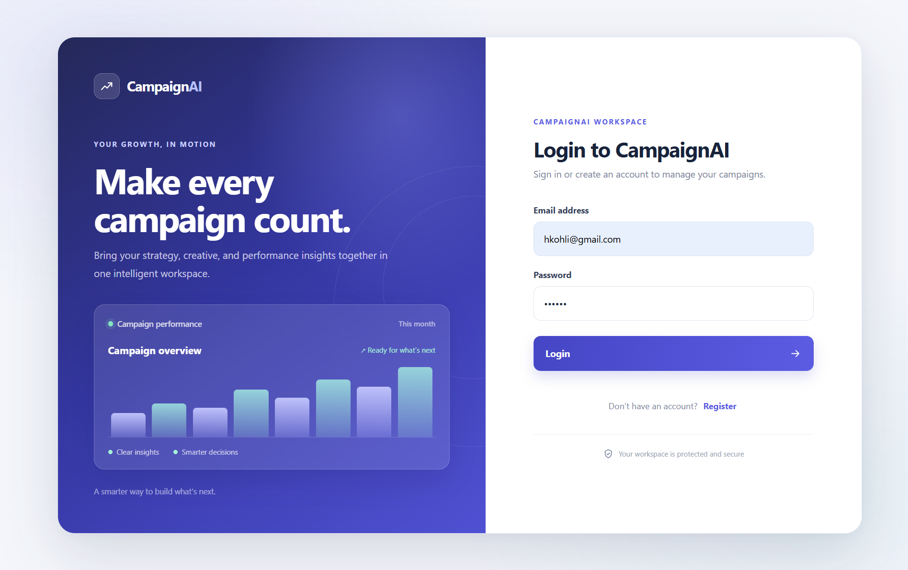
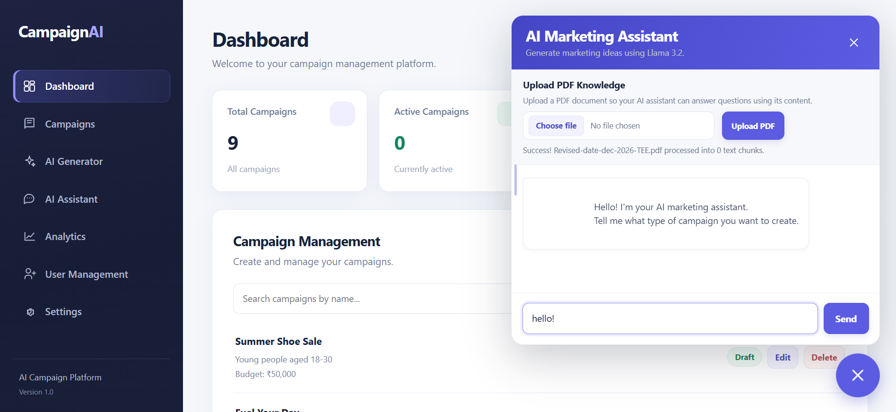
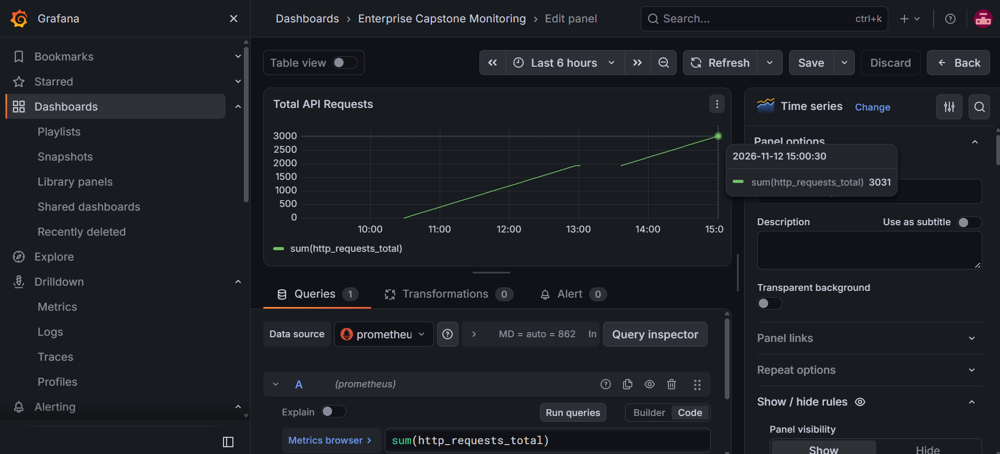
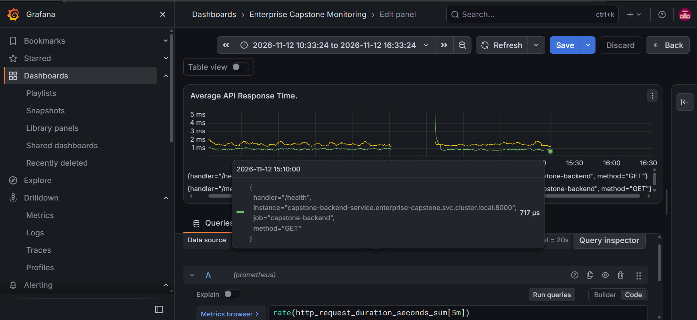
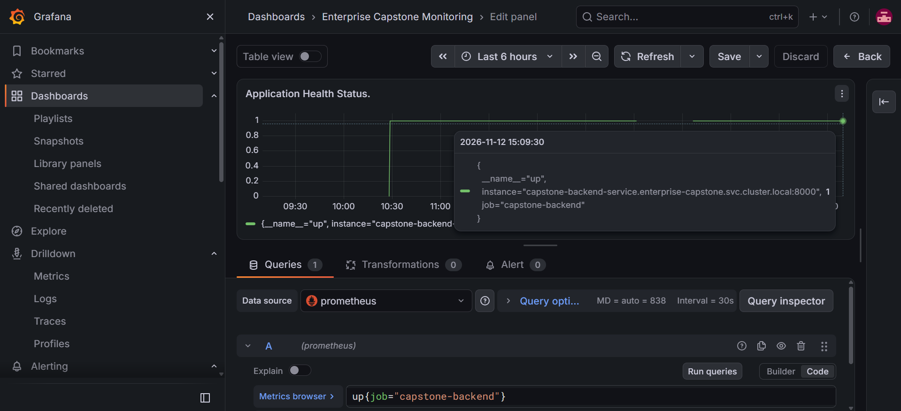

# AI-Powered Campaign Management Platform

An AI-powered campaign management platform built using **FastAPI, PostgreSQL, MongoDB, Redis, Ollama, RAG, Docker, Kubernetes, Prometheus, and Grafana**.

## Project Overview

The AI-Powered Campaign Management Platform helps users create, manage, search, and analyze marketing campaigns using AI-powered features.

The platform also includes an AI chatbot that can answer questions using uploaded PDF documents through **Retrieval-Augmented Generation (RAG)**.

## Features

- **User Management:** User registration, login, password hashing, and JWT authentication.
- **Campaign Management:** Create, view, update, and delete marketing campaigns.
- **AI Campaign Generator:** Generate campaign ideas and marketing strategies using local Ollama Llama 3.2.
- **AI-Powered Campaign Search:** Search campaigns using semantic search.
- **AI Chatbot:** Interact with an AI assistant and ask questions.
- **PDF-Based RAG:** Upload PDF documents, extract text, generate embeddings, and retrieve relevant information with documents scoped to their owner.
- **Analytics Dashboard:** View campaign statistics and API analytics.
- **Caching:** Redis caching for improved application performance.
- **Monitoring:** Prometheus metrics collection and Grafana dashboards.
- **Containerization:** Docker and Docker Compose.
- **Orchestration:** Kubernetes deployments and services.

## Technology Stack

| Component | Technology |
|---|---|
| Backend | Python, FastAPI |
| Frontend | HTML, CSS, JavaScript |
| Relational Database | PostgreSQL |
| NoSQL Database | MongoDB |
| Caching | Redis |
| AI Model | Ollama - Llama 3.2 |
| Embedding Model | nomic-embed-text |
| RAG Vector Database | ChromaDB |
| Authentication | JWT |
| Containers | Docker |
| Orchestration | Kubernetes |
| Monitoring | Prometheus |
| Dashboards | Grafana |

## Project Structure

```text
Enterprise_Capstone/
│
├── backend/
│   ├── main.py
│   ├── config.py
│   ├── database.py
│   ├── mongodb.py
│   ├── cache.py
│   ├── models.py
│   ├── schemas.py
│   ├── security.py
│   └── rag.py
│
├── frontend/
│   ├── index.html
│   ├── style.css
│   └── script.js
│
├── kubernetes/
├── monitoring/
├── docker-compose.yml
├── Dockerfile
├── Dockerfile.frontend
├── requirements.txt
└── .gitignore
```

## Getting Started

### Prerequisites

Make sure the following tools are installed:

- Python
- Docker Desktop
- PostgreSQL (if running outside Docker)
- MongoDB (if running outside Docker)
- Redis (if running outside Docker)
- Ollama
- Kubernetes enabled in Docker Desktop (for Kubernetes deployment)

### 1. Clone the Repository

```bash
git clone https://github.com/kohliweb-dev/AI-Powered-Campaign-Management-Platform.git

cd AI-Powered-Campaign-Management-Platform
```

### 2. Create a Virtual Environment

```bash
python -m venv .venv
```

Activate it in Windows PowerShell:

```powershell
.\.venv\Scripts\Activate.ps1
```

### 3. Install Dependencies

```bash
pip install -r requirements.txt
```

### 4. Configure Environment Variables

Create a `.env` file in the project root directory.

Configure the required environment variables according to your local database and application setup:

```env
POSTGRES_URL=your_postgresql_connection_string
MONGO_URL=your_mongodb_connection_string
REDIS_URL=your_redis_connection_string
SECRET_KEY=your_secret_key
```

Add any additional settings required by your configuration, such as the Ollama service URL.

**Important:** Never upload your `.env` file or expose database credentials and secret keys on GitHub.

### 5. Start Ollama

Install Ollama and download the required AI models:

```bash
ollama pull llama3.2
ollama pull nomic-embed-text
```

Make sure the Ollama service is running before using the AI generator, chatbot, and PDF-based RAG features.

### 6. Run the Backend

Start the FastAPI backend:

```bash
uvicorn backend.main:app --reload --port 8001
```

Backend API documentation:

http://localhost:8001/docs

### 7. Run the Frontend

In another terminal, serve the frontend:

```bash
python -m http.server 5500 --directory frontend
```

Open http://localhost:5500. The frontend connects to the API on port 8001.

## Docker Deployment

Build and start the application using Docker Compose:

```bash
docker compose -f docker/docker-compose.yml up --build -d
```

Check running containers:

```bash
docker compose -f docker/docker-compose.yml ps
```

Application URLs:

| Service | URL |
|---|---|
| Frontend | http://localhost:5500 |
| Backend API | http://localhost:8001/docs |

Stop the containers:

```bash
docker compose -f docker/docker-compose.yml down
```

Docker Compose starts MongoDB for chat history and persists its data in the `mongodb_data` volume. The backend connects to that MongoDB service automatically; `MONGO_URL` in `.env` is used when running the backend outside Docker. Make sure the other required environment variables and Ollama connection are configured correctly for your Docker environment.

## Monitoring

The platform integrates **Prometheus** and **Grafana** for application monitoring and visualization.

The monitoring setup includes:

- Total API Requests
- 95th Percentile API Response Time
- API Requests Per Second
- Backend Availability

Prometheus collects application metrics, while Grafana provides dashboards for visualizing and analyzing the metrics.

## Kubernetes Deployment

Kubernetes configuration files are available in the `kubernetes/` directory.

The project includes Kubernetes deployments and services for running the application components.

Make sure Kubernetes is enabled in Docker Desktop before applying the manifests.

Build the images locally before applying these manifests. The deployments use
`imagePullPolicy: Never`, so after building, load the tagged images into the
Kubernetes node's containerd image store as well. Docker Desktop's host Docker
image store and Kubernetes node image store are separate:

```bash
docker build -t enterprise-capstone-backend:20261119-fix1 -f docker/Dockerfile .
docker build -t enterprise-capstone-frontend:20261119 -f docker/Dockerfile.frontend .
```

For the backend database, create a Kubernetes Secret named
`capstone-postgres-credentials` in the `enterprise-capstone` namespace with
`POSTGRES_USER`, `POSTGRES_PASSWORD`, and `POSTGRES_DB` matching the PostgreSQL
credentials and database in `capstone-secrets`'s `POSTGRES_URL`. Do not commit
the Secret or its values. Create `capstone-mongodb-credentials` in the same
namespace with `MONGO_INITDB_ROOT_USERNAME` and `MONGO_INITDB_ROOT_PASSWORD`
matching the credentials in `capstone-secrets`'s `MONGO_URL`. The PostgreSQL
and MongoDB Deployments store data in persistent volumes.

Example commands:

```bash
kubectl apply -f kubernetes/namespace.yaml
kubectl apply -f kubernetes/postgres.yaml
kubectl apply -f kubernetes/mongodb.yaml
kubectl apply -f kubernetes/
kubectl apply -f monitoring/grafana-pvc.yaml
kubectl apply -f monitoring/prometheus-configmap.yaml
kubectl apply -f monitoring/grafana-deployment.yaml
kubectl apply -f monitoring/grafana-service.yaml
kubectl apply -f monitoring/prometheus-deployment.yaml
kubectl apply -f monitoring/prometheus-service.yaml
```

Check the deployment status:

```bash
kubectl get pods -n enterprise-capstone
kubectl get services -n enterprise-capstone
```

For local access to the backend API in Docker Desktop Kubernetes, run:

```bash
kubectl port-forward service/capstone-backend-service 8002:8000 -n enterprise-capstone
```

Then open http://localhost:8002/docs. Docker Compose uses host port `8001`.

Note: Apply the manifests according to their dependencies and ensure the required Kubernetes secrets and configuration are available.

## AI and RAG Workflow

The platform uses Retrieval-Augmented Generation (RAG) to answer questions using information from uploaded PDF documents.

Workflow:

1. The user uploads a PDF document.
2. The application extracts text from the PDF.
3. The extracted text is divided into smaller chunks.
4. Ollama generates embeddings using `nomic-embed-text`.
5. The embeddings are stored in ChromaDB.
6. Users can choose only their own uploaded PDFs; administrators can access all PDFs.
7. The user asks a question through the AI chatbot.
8. Up to five relevant chunks are retrieved using semantic similarity search.
9. The retrieved information is provided to the AI model, and the chat indicates whether PDF context was found.

## Future Improvements

- OpenAI API integration.
- Additional AI-powered campaign recommendations.
- Advanced analytics and reporting.

## Author

**HK**

GitHub: https://github.com/kohliweb-dev

## Project Repository

https://github.com/kohliweb-dev/AI-Powered-Campaign-Management-Platform

---

## Application Screenshots

### Main Dashboard


### AI Chatbot and RAG



## Grafana graphs screenshots

## total API request


## average api response time


## application-health-status



*Developed as an Enterprise Capstone Project.*